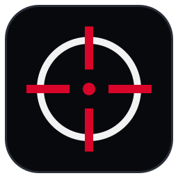

<div align="center">



# THE VOID CROSSHAIR

**A light crosshair overlay for any game or screen, built for Linux: X11 and Wayland, KDE, GNOME and tiling desktops.**

CachyOS / Arch Linux · works on any distro · Python · Qt 6


</div>

---

## Why this exists

[CrossOver](https://github.com/lacymorrow/crossover) is a great cross-platform crosshair
overlay, but it's an Electron app and its own docs say the transparent overlay works best on
X11. On Wayland, the default on KDE Plasma 6 and GNOME, it can show a black box. THE VOID
CROSSHAIR is an independent rewrite for Linux:

| | THE VOID CROSSHAIR |
|---|---|
| **Wayland** | Runs through XWayland automatically, so the overlay is transparent, exactly centred and drawn above borderless-fullscreen games. Tested on KDE Plasma 6 (Wayland). |
| **Global shortcuts** | Through the desktop portal (KDE Plasma 6, GNOME 48+, Hyprland). Your desktop owns the keys and asks you once; nothing reads your keyboard. |
| **Light** | Native Qt instead of a bundled Chromium. The overlay is a tiny click-through window that repaints only when you change it. |
| **Terminal control** | `void-crosshair toggle`, `preset Sniper`, `move 0 -1` and more. Bind them anywhere (sway, i3, Hyprland, any DE) or script them. |
| **Vector crosshairs** | 11 styles drawn sharp at any size: cross, cross dot, T, X, dot, circle, circle dot, circle cross, chevron, square and triangle. Colour, size, thickness, gap, centre dot, outline, opacity and rotation are all adjustable. Or use any PNG / SVG / WebP image, optionally tinted. |
| **Presets** | 7 built in, unlimited of your own, with JSON import / export to share them. |
| **Multi-monitor** | Pick a display, hop to the next one with a shortcut, or mirror the crosshair on all of them. |
| **Hold to hide** | A shortcut that hides the crosshair only while held, e.g. while scoped in. |

## Install

### AppImage (any distro)

Download `THE-VOID-CROSSHAIR-1.0.0-x86_64.AppImage` from the Releases page, then:

```bash
chmod +x THE-VOID-CROSSHAIR-1.0.0-x86_64.AppImage
./THE-VOID-CROSSHAIR-1.0.0-x86_64.AppImage
```

To add it to the application menu, with a `void-crosshair` terminal command (run this from a
clone of this repository):

```bash
bash scripts/install-desktop.sh --appimage THE-VOID-CROSSHAIR-1.0.0-x86_64.AppImage
```

### Arch Linux / CachyOS package

```bash
git clone https://github.com/MRVIMA/the-void-crosshair.git
cd the-void-crosshair/packaging/arch
makepkg -si
```

It uses the system's `pyside6` and `python-jeepney`, both from the official repositories.

### From source

```bash
sudo pacman -S --needed python pyside6 python-jeepney
bash scripts/install-desktop.sh       # runs from this folder; adds the menu entry
```

Remove any of these with `bash scripts/install-desktop.sh --remove`.

## Use

Open **THE VOID CROSSHAIR** from the application menu. The crosshair appears at the centre of
your main display and the settings window opens. Every change applies live. Closing the window
keeps the crosshair on screen; quit from the tray icon or the **QUIT** button.

**Play in borderless / windowed-fullscreen mode.** Exclusive fullscreen and gamescope sessions
draw over every other window, overlays included.

### Shortcuts

On first start your desktop asks you to allow the shortcuts. You can change them later in
**System Settings → Shortcuts**, or from **CHANGE KEYS…** in the app.

| Action | Default |
|---|---|
| Show / hide | <kbd>Ctrl</kbd>+<kbd>Alt</kbd>+<kbd>Shift</kbd>+<kbd>H</kbd> |
| Hide while held | <kbd>Ctrl</kbd>+<kbd>Alt</kbd>+<kbd>Shift</kbd>+<kbd>J</kbd> |
| Open settings | <kbd>Ctrl</kbd>+<kbd>Alt</kbd>+<kbd>Shift</kbd>+<kbd>X</kbd> |
| Next / previous style | <kbd>Ctrl</kbd>+<kbd>Alt</kbd>+<kbd>Shift</kbd>+<kbd>N</kbd> / <kbd>B</kbd> |
| Back to centre | <kbd>Ctrl</kbd>+<kbd>Alt</kbd>+<kbd>Shift</kbd>+<kbd>C</kbd> |
| Next display | <kbd>Ctrl</kbd>+<kbd>Alt</kbd>+<kbd>Shift</kbd>+<kbd>M</kbd> |
| Nudge 1 px | <kbd>Ctrl</kbd>+<kbd>Alt</kbd>+<kbd>Shift</kbd>+<kbd>↑↓←→</kbd> |

No portal, e.g. on sway or i3? Bind the terminal commands instead. Hyprland example:

```ini
bind = CTRL ALT SHIFT, H, exec, void-crosshair toggle
```

### Terminal

```bash
void-crosshair                  # start, or open the settings of the running copy
void-crosshair toggle           # show / hide           (also: show, hide)
void-crosshair preset Sniper    # apply a preset
void-crosshair next             # next style            (also: prev)
void-crosshair move 0 -2        # nudge by pixels       (also: center, screen)
void-crosshair set color 00FFFF  # hex, with or without "#" (quote it if you use #)
void-crosshair set size 30      # any setting: style, thickness, gap, dot, opacity, rotation, …
void-crosshair status           # current settings as JSON
void-crosshair quit
void-crosshair --background     # start without the settings window (used by autostart)
```

### Good to know

- Settings and presets are saved in `~/.config/the-void-crosshair/settings.json`.
- **SHORTCUTS & SYSTEM → Start with the system** adds an autostart entry, so the crosshair is
  on and the window stays closed.
- To force native Wayland, start with `--wayland`. The desktop then decides where the window
  goes, so XWayland, the default, is the better choice for an overlay.
- A crosshair overlay only draws on top of your screen. It never reads or changes any game,
  but some competitive games and leagues have rules about overlays, so check before ranked
  play.

## Development

```bash
bash scripts/setup.sh           # .venv with the system PySide6, editable install
bash scripts/run.sh             # run from source
bash scripts/test.sh            # lint + tests (offscreen Qt; no network, no portal)
USE_SYSTEM_PYSIDE=1 bash packaging/appimage/build-appimage.sh   # build the AppImage
```

Build release AppImages on an old base system (e.g. Ubuntu 22.04, without
`USE_SYSTEM_PYSIDE`) so they run on most distributions.

| Module | Purpose |
|---|---|
| `void_crosshair/config.py` | Settings, ranges, built-in presets, JSON storage |
| `void_crosshair/render.py` | Draws every style (QPainter) and image crosshairs |
| `void_crosshair/overlay.py` | The transparent, click-through, always-on-top window |
| `void_crosshair/controller.py` | Overlays per display, commands, presets, tray icon |
| `void_crosshair/shortcuts.py` | Global shortcuts via the XDG desktop portal |
| `void_crosshair/control.py` | Single instance + terminal commands (Unix socket) |
| `void_crosshair/window.py` | Settings window (THE VOID theme) |
| `void_crosshair/desktop.py` | Autostart, XWayland / Wayland choice |

## Credits

A **THE VOID** project by **THE VOID PROTOCOL** · Owner of THE VOID: **MRVIMA** (alias **VOIDVIMA**)

Inspired by [CrossOver](https://github.com/lacymorrow/crossover) by Lacy Morrow. THE VOID
CROSSHAIR is an independent rewrite with its own code and artwork; it contains no CrossOver
code or crosshair images and isn't affiliated with CrossOver.
Fonts: Rajdhani, Inter, JetBrains Mono (SIL Open Font License; licenses in `void_crosshair/assets/fonts/`).

## License

[MIT](LICENSE) © 2026 THE VOID PROTOCOL
